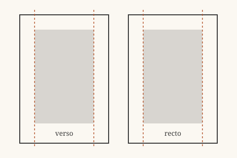

# The Quiet Page

## A Page Is a Room

Most of what makes a page pleasant goes unnoticed. The reader sees words, not the margins around them, not the space between the lines, not the way a paragraph begins. When those things are right, the text simply feels "easy," and the reader keeps going without asking why.

This little book walks through a few of those invisible decisions. It is also a test: every chapter uses some Markdown feature, so you can open the EPUB and see how each one comes out.[^why]

Good typography is a series of small refusals --- refusing to crowd, refusing to shout, refusing to make the reader work for something the designer should have done.

> The best page is the one you forget you are reading.
> It steps aside and lets the voice through.

### Measure and leading

The *measure* is the length of a line. Somewhere between 45 and 75 characters is the classic range; shorter lines feel jittery, longer lines make the eye lose its place on the return trip. *Leading* is the space between lines, and it should grow as the measure grows.

| Setting        | Comfortable range | What goes wrong outside it     |
|:---------------|:-----------------:|:-------------------------------|
| Measure        | 45–75 characters  | The eye loses the next line    |
| Leading        | 1.3–1.6 × size    | Lines merge or drift apart     |
| Paragraph gap  | one indent        | Pages look like a list         |

## Where the Margins Go



On a printed spread, the inner margins are narrower than the outer ones, because the two inner margins read as a single gutter. A reading app does not have spreads in the same way, so md2epub leaves margins to the app and to you.[^margins]

==Reading apps let the reader choose font, size and margins==, so a good stylesheet sets proportions rather than absolutes. Everything in md2epub's stylesheet is in `em` units for exactly that reason.

> [!tip] Try it yourself
> Change the font size in your reading app. Headings, code and tables should all scale together.

## Small Things

Typographers care about characters most people never type:

- “Curly quotes” instead of "straight" ones --- written here as plain quotes in the Markdown;
- an en dash for ranges, as in 1990--2000, and an em dash for a break in thought;
- an ellipsis... as one character, not three dots.

Checklists come out as boxes, too:

- [x] Write the Markdown
- [x] Run `md2epub sample.md`
- [ ] Read it somewhere comfortable

Term
: A definition list explains a word.

Another term
: And the explanation can run on for a while, wrapping onto the next line just like a paragraph.

## Code on a Small Screen

Code is the one place where text must not reflow freely, but a reading app cannot scroll sideways either. md2epub wraps long lines and keeps the colour of the syntax:

```python
def measure(text: str, characters_per_line: int = 66) -> list[str]:
    """Break text into lines of at most characters_per_line characters."""
    lines, current = [], ""

    for word in text.split():
        if len(current) + len(word) + 1 > characters_per_line:
            lines.append(current)
            current = word
        else:
            current = f"{current} {word}".strip()
    return lines + [current]
```

Inline code such as `hyphens: auto` stays in a monospaced face, and it never hyphenates.[^code]

---

That rule above is a scene break: a pause, not a new chapter. Back in [the first chapter](#a-page-is-a-room) there was a table; links like that one work across chapter files.

[^why]: Every feature is here on purpose. If something looks wrong, the sample is the first place to check.
[^margins]: Apple Books, Kobo and Kindle each add their own margins. A stylesheet that adds more makes the text column too narrow on a phone.
[^code]: Hyphenating code would change its meaning, so the stylesheet turns hyphenation off for it.
